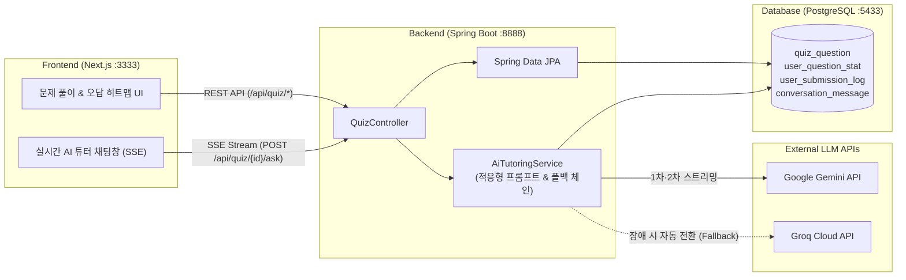

# 🧭 WAYPOINT (웨이포인트)

> **"막막한 공부에 확실한 방향을 찍어주는 곳, 1:1 AI 과외 파트너 WAYPOINT 🧭"**
> 
> 내 속도에 맞춰 성장의 이정표를 세우고, 모르는 문제부터 완벽한 이해까지 함께 걷는 맞춤형 AI 튜터링 & 문제 풀이 플랫폼입니다.

---

## ✨ 프로젝트 소개 (Overview)

혼자 자격증이나 시험을 준비할 때 가장 막막한 순간은 **"해설을 읽어도 왜 틀렸는지 이해가 안 될 때"**와 **"내가 어느 부분에서 자꾸 틀리는지 모를 때"**입니다.

**WAYPOINT**는 단순한 문제 은행(CBT)을 넘어, 학습자의 **문제별 오답 횟수와 이전 질문 맥락을 기억하는 1:1 AI 과외 선생님**을 결합한 학습 플랫폼입니다. 
내가 자주 틀리는 약점 문제를 시각적인 히트맵으로 한눈에 파악하고, 막히는 순간마다 옆에 앉은 과외 선생님에게 질문하듯 실시간 스트리밍으로 눈높이 해설을 받아볼 수 있습니다.

---

## 🎯 핵심 기능 (Key Features)

### 1. 🧑‍🏫 내 오답 이력을 알고 있는 1:1 AI 과외 튜터 (Adaptive AI Tutoring)
- **오답 횟수 기반 눈높이 설명**: 학습자가 해당 문제를 몇 번 틀렸는지(`wrongCount`) 자동으로 분석하여 프롬프트를 동적으로 구성합니다.
  - **1~2회 오답 시**: 헷갈리기 쉬운 핵심 개념 위주로 명확하게 교정
  - **3회 이상 반복 오답 시**: 단순 해설 대신 **왜 특정 보기가 매력적인 오답(함정)으로 유도되는지** 짚어주고, **실생활 비유 및 암기 팁**을 포함한 밀착 과외 모드 작동
- **멀티턴 대화 맥락 기억 (Context-Aware)**: 이전 질문과 답변 내역(Sliding Window)을 기억하여 꼬리에 꼬리를 무는 심화 질문이 가능합니다.
- **실시간 SSE 스트리밍 & 마크다운 렌더링**: 답변 생성 과정을 기다릴 필요 없이 실시간 타이핑 효과로 즉시 확인하며, 표·코드·강조 구문 등 가독성 높은 마크다운으로 해설을 제공합니다.

### 2. 🛡️ 끊김 없는 멀티 LLM 폴백 아키텍처 (Multi-LLM Fallback Chain)
외부 AI API의 일시적 장애나 속도 저하에도 과외가 중단되지 않도록 **4단계 자동 폴백 체인**을 구성했습니다.
1. `Gemini 3.5 Flash` (Primary)
2. `Gemini 3.8 Flash` (Fallback 1)
3. `Groq - Qwen 3.8 27B` (Fallback 2)
4. `Groq - OpenAI GPT-OSS 20B` (Fallback 3)

### 3. 🔥 오답 히트맵 & 정밀 학습 트래킹 (Wrong-Answer Heatmap & Analytics)
- **오답 그라데이션 히트맵**: 미풀이 / 한 번에 정답(Perfect) / 오답 후 해결(Resolved) / 반복 오답(1회~4회+) 상태를 색상 그라데이션으로 시각화하여 나의 취약 구간을 직관적으로 안내합니다.
- **모든 풀이 타임라인 기록**: 문제별 시도 횟수(`tryCount`), 오답 횟수(`wrongCount`), 매 시도에서 선택한 선지와 채점 일시를 모두 기록하여 성장을 추적합니다.
- **나만의 질문 노트**: 문제별로 AI 튜터와 나눈 질의응답 쌍(Q&A Pair)을 모아보고 관리(개별/전체 삭제)할 수 있습니다.

---

## 🛠️ 기술 스택 (Tech Stack)

| 구분 | 기술 스택 |
| :--- | :--- |
| **Frontend** | Next.js 16 (App Router), React 19, TypeScript 5, Tailwind CSS v4, `react-markdown`, `remark-gfm` |
| **Backend** | Java 17, Spring Boot 4.1, Spring Data JPA, Spring Security, Spring WebFlux (`WebClient` + `SseEmitter`) |
| **Database** | PostgreSQL 15 (Alpine) |
| **AI / LLM** | Google Gemini API, Groq Cloud API (Multi-Fallback Streaming) |
| **Infra / DevOps** | Docker, Docker Compose |

---

## 🏗️ 시스템 아키텍처 (Architecture)



---

## 📂 디렉터리 구조 (Directory Structure)

```text
waypoint-platform/
├── docker-compose.yml          # 전체 서비스(DB, Backend, Frontend) 컨테이너 오케스트레이션
├── init/                       # PostgreSQL 초기 스키마 및 기출·자체제작 문제 시드 SQL
│   ├── 01_schema.sql
│   └── 02_all_quiz_questions.sql
├── next-js-app/                # Next.js 16 프론트엔드 애플리케이션
│   ├── app/
│   │   ├── page.tsx            # 메인 학습 대시보드, 문제 풀이, 히트맵, AI 튜터 UI
│   │   ├── layout.tsx
│   │   └── globals.css
│   └── package.json
└── spring-boot-app/            # Spring Boot 백엔드 애플리케이션
    ├── src/main/java/xyz/waypoint/
    │   ├── config/             # Security, CORS, AuthInterceptor 설정
    │   ├── controller/         # QuizController, AuthController
    │   ├── domain/             # QuizQuestion, UserQuestionStat, UserSubmissionLog, ConversationMessage
    │   ├── repository/         # JPA Repositories
    │   └── service/            # AiTutoringService (적응형 프롬프트 & 멀티 LLM SSE 스트리밍)
    └── build.gradle
```

---

## 🚀 시작하기 (Getting Started)

### 1. 환경 변수 설정 (`.env`)
프로젝트 루트 경로에 `.env` 파일을 생성하고 DB 정보 및 AI API 키를 설정합니다.

```env
POSTGRES_DB=db
POSTGRES_USER=username
POSTGRES_PASSWORD=password

# AI 튜터 스트리밍을 위한 API Key
APP_GEMINI_API_KEY=your_gemini_api_key_here
APP_GROQ_API_KEY=your_groq_api_key_here
```

### 2. Docker Compose로 한 번에 실행하기 (권장)
Docker가 설치되어 있다면 아래 명령어 한 줄로 DB 초기화(스키마 + 문제 데이터 적재), 백엔드, 프론트엔드를 모두 실행할 수 있습니다.

```bash
docker-compose up -d --build
```

- **Frontend 웹 접속**: `http://localhost:3333`
- **Backend API 서버**: `http://localhost:8888`
- **PostgreSQL DB**: `localhost:5433`

### 3. 로컬 개발 모드로 개별 실행하기

**Backend (Spring Boot)**
```bash
cd spring-boot-app
./gradlew bootRun
```

**Frontend (Next.js)**
```bash
cd next-js-app
npm install
npm run dev
```

---

## 📡 주요 API 명세 (API Endpoints)

| Method | Endpoint | 설명 |
| :---: | :--- | :--- |
| `GET` | `/api/quiz` | 전체 또는 카테고리별 문제 목록 조회 (`?category=`) |
| `GET` | `/api/quiz/{id}` | 특정 문제 상세 조회 |
| `POST` | `/api/quiz/{id}/submit` | 답안 제출 및 채점, 누적 오답 통계(`UserQuestionStat`)·제출 로그 기록 |
| `GET` | `/api/quiz/stats` | 사용자의 전체 학습 통계, 문제별 오답 현황, 풀이 로그 및 대화 내역 조회 |
| `POST` | `/api/quiz/stats/reset` | 사용자의 풀이 통계 및 제출 기록 초기화 |
| `POST` | `/api/quiz/{id}/ask` | **1:1 AI 과외 튜터에게 질문하기 (`text/event-stream` SSE 실시간 응답)** |
| `GET` | `/api/quiz/{id}/conversations` | 특정 문제에 대한 AI 튜터와의 이전 대화 내역 조회 |
| `DELETE` | `/api/quiz/conversations/{messageId}` | 특정 질문/답변 대화 쌍 삭제 (`?pairId=`) |
| `DELETE` | `/api/quiz/{id}/conversations` | 특정 문제의 AI 튜터 대화 내역 전체 삭제 |
